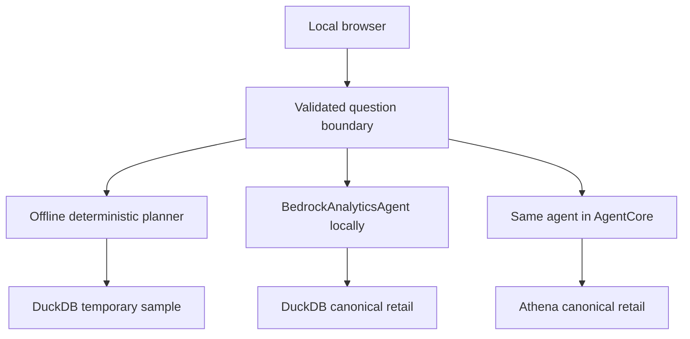
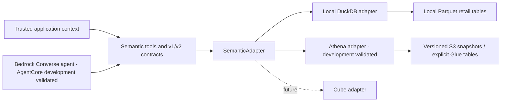

# Architecture

## Local testing UI

The separately requested Analytics Workbench serves local assets on loopback without
additional dependencies. It has three modes: the default offline deterministic
playground, an explicit billable local Bedrock agent with canonical DuckDB data, and
an explicit billable AWS AgentCore agent with Athena. Both live runners use the
existing `BedrockAnalyticsAgent`, catalog, v2 contracts, question guard and semantic
tools. The generated offline sample is labeled separately. See [setup](local-ui.md)
and the [release evidence/proposal](ui-shared-code-live.md).

Trusted Python configuration supplies authorization; browser payloads cannot set
scope, history, model or quota purpose. The AWS payload contains only the question.
Provider clients and fresh artifact/configuration/publication checks belong in
`adapters/ui_shared.py`, `ui_release.py` and `ui_local_agent.py`. Deployment is a
separate operator command in `infrastructure/agentcore/ui_workflow.py`; HTTP has no
mutation route. Its bounded controller reconciles full templates, parameters,
artifact/configuration and Runtime/DEFAULT proofs; READY alone is insufficient.

`ui/shared.py` maintains one separate allowance for both billable modes. Exclusive,
fsynced question and SDK receipts precede dispatch, with journal reconciliation,
mode/purpose/request binding, no SDK retries and expiry enforcement. Eighteen regular
questions plus protected verification/rollback slots fit within 20. Failure/unknown
outcomes stop normal dispatch; a valid rollback slot remains protected. Existing
operator/deployment leases prevent overlap without rewriting historical evidence.
Source audit proves the accepted candidate's 25-file common closure matches. The
approved November 11, 2026, execution deployed that frozen candidate and trusted
retail configuration; final exact preflight verified Runtime/DEFAULT **READY v13**
and runtime stack **UPDATE_COMPLETE**. Q18 verification and all eighteen actual-UI
paired outcomes passed independent expected requests/results, including all five
metrics, filtering, relative dates, clarification and authorization boundaries.
This proves the tested scope rather than identical model output or production
equivalence. The matching candidate remains deployed; original rollback was not needed.

The separate campaign consumed nineteen attempts: verification one and regular
questions eighteen. Its protected original-restoration smoke remains unused; it is
not an extra ordinary question. The regular cap blocks both agent modes and the
billable CLI startup path. Further live questions require another explicit reviewed
allowance; no historical counter or current receipt is reset. Saved-mode viewer
reports derived from the authoritative paired report create no AWS session and
retain their replay label. A default/offline launch remains available after the
live cap is reached. The independent original rollback artifact/configuration,
historical acceptance evidence and all earlier ledgers remain preserved.

The UI implementation merged through [PR #8](https://github.com/sureshkm-ai/enterprise-analytics-agent/pull/8) on November 11, 2026, at `e22287538e22e1917eb2a21efbeadc4cec5c6d75`. The full-live follow-up merged through [PR #9](https://github.com/sureshkm-ai/enterprise-analytics-agent/pull/9) at `1dfd788a9b773fbf8abd39a554033cccd683c4ee`; [main CI 43100659276](https://github.com/sureshkm-ai/enterprise-analytics-agent/actions/runs/43100659276) passed for that merge. Historical v13 UI and v15 full-validation proofs remain distinct.

The [next interactive review](ui-interactive-session-02.md) reuses the accepted
candidate-retail artifact/configuration without changing application code or deploying.
A fresh read-only proof at 21:26:03Z on November 11, 2026, verified READY v15. A new
review and actual-version record bind the new campaign; previous records/ledgers stay
immutable. Its one Q18 verification plus 18 regular questions require explicit
approval. The existing schema's original-rollback slot remains unavailable in this
no-deployment scope; failures stop dispatch and preserve retail v15. Preparation
creates no new question ledger and does not enable billable modes.

Saved responses and suite reports are validated data, displayed with recorded verdicts
and explicit replay labels. No saved answer is presented as a fresh local or live query.
Exact values are rendered directly from typed semantic results. Questions and reports
are inserted as text, never HTML. The HTTP boundary restricts Host/Origin, requires a
per-process POST token, serves only known assets and keeps credentials server-side.

## Boundaries

The agent consumes backend-independent semantic contracts. AWS-specific and Cube-specific logic belongs in adapters. `contracts.py`, `contracts_v2.py`, and `adapter.py` must not import provider clients, DuckDB types, or SQL. Milestones 1–3 provide the verified DuckDB/Athena semantics. Milestone 4 implements the Converse agent and AgentCore hosting. Its approved development deployment passed 24 authored live tests plus warm-up; corrected parity-v1 is restored with Runtime/DEFAULT READY on version 4. Milestone 4 is implemented, deployed, live-validated, merged into main through [PR #4](https://github.com/sureshkm-ai/enterprise-analytics-agent/pull/4) on November 8, 2026, and verified by hosted CI for the agreed development scope. Merge [`47c3afc1dd948fa8ddcb074151b9f22af31dad48`](https://github.com/sureshkm-ai/enterprise-analytics-agent/commit/47c3afc1dd948fa8ddcb074151b9f22af31dad48) passed [main CI 42516820774](https://github.com/sureshkm-ai/enterprise-analytics-agent/actions/runs/42516820774); completion-commit push/PR runs are recorded separately in [progress](progress.md).

The four semantic tools are `discover_metrics`, `describe_metric`, `query_metric`, and `discover_dimensions`. Metric definitions own calculations, allowed dimensions, relationships, filters, units, and time semantics. The catalog is the source of governed configuration; an adapter translates the supported calculation into backend execution rather than accepting a user expression.

`catalog.MetricSpecification` is internal governed configuration. V1/v2 public metric definitions are explicit business projections. Description and dimension-discovery responses include logical names, business rules, units, order-item/order grains, and order-date semantics; v2 also describes precision, nullability, and original-period adjustments. Execution expressions, source mappings, and tenant-scoped join keys remain internal. Public JSON schemas omit those details too. Adapters translate the catalog's closed calculation identifiers into SQL; model-supplied expressions are never evaluated.

## Contracts and authorization

V1 models and net revenue wire schemas remain unchanged, with v1 discovery advertising only net revenue. V2 models add all five metrics, currency/count/ratio units, order grains, nullable ratio results, and explicit null currency for nonmonetary results. Separate typed requests select the version for each of the four operations; every response and nested object uses the matching version. New metrics through v1 fail clearly. Incompatible published changes require a new version.

Unknown fields and unsupported versions are rejected. Dates are date objects or ISO `YYYY-MM-DD` strings, never timestamps. A date range is `[start, end)` with `start < end`. Currency/ratio values serialize as decimal strings; counts as JSON integers. V2 forbids binary floats and validates unit/currency/value precision consistency.

`AuthorizationContext` is passed separately by trusted application code and contains a principal, tenant, and explicit allowed regions. The context is never part of model-visible request schemas. Empty region scope denies all access. All four adapter methods check the context; query execution and dimension discovery also apply tenant and region restrictions. Requests cannot override these restrictions. The local CLI constructs its context as application configuration, not as command-line identity options.

This enforces a local trust boundary. Production must authenticate the application principal and derive tenant and region scope from verified claims or a policy service before constructing this context. A Pydantic object alone does not authenticate a user.

## Local storage and execution

Six required Parquet files contain customers, products, orders, order items, payments, and refunds. A seventh, optional `returns.parquet` stores physical item-return events with tenant-scoped event keys, quantities, event/received dates, and explicit received/pending/rejected statuses. It is required by return-rate execution, even for empty query ranges; absence raises a missing-source error, while an empty typed source is valid. Legacy six-table snapshots retain net revenue and support the other metrics except return rate.

Monetary values are signed 64-bit integer cents at rest. Synthetic returns use a separate seed stream after original records are complete; frozen logical fingerprints protect the original six tables for two seeds. Order region and channel are historical attributes stored on the order, so customer changes cannot restate dimensions.

The adapter loads a snapshot into its own in-memory DuckDB connection. Exact repeated records collapse by tenant-scoped business key; contradictory records sharing a key fail. Approved refunds aggregate per item before item joins. Received physical returns first become distinct returned-order flags. Eligible items then aggregate into one row per order, followed by the requested output groups. Payments never join these aggregations, and an order without items is excluded. The existing net revenue formula and eligibility are unchanged.

Ratios divide the final grouped integer numerators and denominators, never subgroup averages. Integer quotient/remainder arithmetic implements final ROUND_HALF_UP without intermediate rounding or dependence on the caller's Decimal precision. Average order value has two places and return rate six; zero denominators yield null. Return-rate flags cannot count an order more than once. Request/auth values use bound parameters; SQL identifiers come from the governed catalog.

Local snapshot ingestion assumes application-controlled Parquet. This milestone does not implement arbitrary uploads, schema migrations, streaming updates, warehouse governance, or a policy service. Reopen the adapter to observe changed files. Use its context manager to close the connection.

Ingestion requires exact storage types, nonnull required fields, nonnegative source amounts, positive item quantities, discounts no greater than line gross, and tenant-scoped relationships. Approved refunds require an approval date; received returns require a received date. Return quantities must be positive and no greater than purchased item quantity. Optional sources are validated when present. These checks reject malformed snapshots rather than silently discarding records. Over-refunds can produce negative net revenue/AOV. There is no full financial or cumulative physical-return ledger reconciliation.

## Verification automation

Push/PR CI uses read-only repository permissions, Python 3.12, immutable action SHAs, pinned Poetry 2.3.1 in a separate environment, and locked project installation. It checks the lockfile, tests, Ruff lint/format, and mypy. CI has no AWS credentials. Local work continues in the existing `enterprise-analytics` Conda environment; CI creates an isolated project environment instead. Hosted workflow execution requires a user-initiated push and is not part of local verification.

The separate full-live verification operator keeps ordinary CI offline with explicit
marker selection and `--fail-on-skip`. A selected skip fails the phase; unselected
live items are never reported as passed. The reviewed all-tests workflow executes
66 Athena items, one 36-request retail item and 18 parity-agent items in stages,
using a new durable budget and candidate-aware trusted runner injection. It preserves
the existing public contracts and historical closed counters, then restores the
accepted candidate/retail state with a protected Q18 smoke. See
[the full-live plan](full-live-validation-plan.md). The first attempt's stale CDK asset
URL was rejected by strict reconciliation. Asset validation now binds template bytes,
stack URL, asset ID/source and every destination before AWS setup. The separately
approved [continuation](full-live-continuation-proposal.md) passed all 18 parity items
and protected smoke, preserving the blocked 37-call parent. Combined acceptance is
**1,570 offline + 85 live items, zero skips**; new 20/20 and aggregate 57/57 Runtime calls.
Parity v14 was fully verified, then accepted candidate-retail was restored and finally
verified READY v15 at 19:59:56Z on November 11, 2026. Runtime source, contracts, metrics,
permissions and all historical ledgers are unchanged; no allowance remains in those
completed campaigns. The merged implementation passed main CI 43100659276: 1,570
offline tests, zero skips, and the remaining required checks. The 85 live results
remain separate from hosted CI and any later proposed interactive allowance.

## Future integrations

Milestone 4 adds Bedrock and AgentCore Runtime, without Gateway, Memory, Browser, Code Interpreter, or managed Evaluations. Cube and a UI remain later separate work. External SDK usage must be checked against current official documentation, with references recorded. Provider-specific identity propagation, query lifecycle, credentials, and errors remain in adapters or trusted hosting code.

For local implementation, official references checked on 2026-11-05 include [DuckDB's Python API](https://duckdb.org/docs/stable/clients/python/overview), [Pydantic configuration](https://docs.pydantic.dev/latest/api/config/), and [Poetry project configuration](https://python-poetry.org/docs/pyproject/).

CI references checked on 2026-11-05: [checkout v7.0.1](https://github.com/actions/checkout/releases/tag/v7.0.1), [setup-python v7.1.0](https://github.com/actions/setup-python/releases/tag/v7.1.0), [Poetry installation/CI guidance](https://python-poetry.org/docs/#ci-recommendations), and [Poetry CLI](https://python-poetry.org/docs/cli/). Action release refs were resolved to full commit SHAs in the official repositories. Local `poetry sync --help` confirmed the pinned Poetry version supports the workflow flags.

## AWS data and Athena execution boundary

`snapshots.py` prepares storage-independent canonical Parquet and manifest metadata using the existing validation boundary. AWS naming, SDK configuration, conditional S3 publication, and schema verification are under `adapters`; CDK resources are under `infrastructure/cdk`. Source files are frozen before validation/publication to prevent mutation of the original directory from changing uploaded bytes.

Each configured version has separate S3 table locations and deterministic Glue names derived from its version hash. Six legacy tables are required; returns is optional in inventory. A missing required source fails before query submission. Tables are declared explicitly by CDK, not inferred by a crawler or mutated by the data loader. Source permissions allow only canonical file/manifest keys, with conditional writes; results are in a different bucket. A failed upload leaves an unpublished prefix and never silently marks it ready.

The Athena SQL compiler translates the catalog's five expressions and governed identifiers, encodes validated strings/dates as Athena execution-parameter literals, and keeps placeholders in WHERE clauses. It casts monetary integer arithmetic to DECIMAL(38,0), preaggregates refunds, deduplicates return orders, and uses the same aggregate-ratio/final-rounding rules as DuckDB. Athena's 38-digit aggregate bound is explicit; values are never converted through float.

The executor bounds polling and transient retries, retains submission tokens across uncertain API retries, and resubmits only explicitly retryable terminal failures. Abnormal exits after receiving a query ID request best-effort cancellation while the query may still be running; known terminal executions are never stopped. Cleanup uses a separate bounded scheduling budget and preserves the original exception. Finite SDK socket timeouts bound in-flight calls, which can outlast that scheduling budget. Cancellation request acceptance does not establish confirmed CANCELLED status. It validates first-page headers, all pages/types/nulls, and pagination tokens. Private diagnostic records contain query IDs, bytes and timings, dataset/metric versions, operation/status, and cancellation attempts/outcomes; public v1/v2 schemas are unchanged.

Application authorization always intersects the trusted tenant/region context with model-supplied dimension filters. It does not enforce database-level row security: the development query role can query every row in its approved source snapshots and read result objects. IAM-compatible Glue defaults apply only to this new database; existing account-level Lake Formation settings are not changed, and no Lake Formation row-level-security claim is made.

## Development deployment and validation

The selected development target is `analytics-dev`, account `453711491609`, region `us-west-2`. The user reports `CDKToolkit` and `enterprise-analytics-dev-data-layer` in `CREATE_COMPLETE`, followed by a user-executed live parity run with **66 passed, 458 deselected in 111.94s**. These results were not rerun during this documentation update. The [deployment plan](aws-deployment-plan.md) records the reviewed resources, scoped deployment policy, retention/cost controls, commands, cleanup, and official AWS/CDK/Boto3 references; this update does not independently verify the deployed IAM configuration.

Offline tests use injected clients and local SQL-subset execution, not AWS credentials. CDK assertions and synthesis run without account lookups. Explicit live tests require both `--run-aws` and reviewed configuration and compare Athena and DuckDB with independent fixture answers; missing configuration fails rather than reporting skipped acceptance. The user-reported run establishes development live parity for the tested cases. Cancellation fault handling has local regression coverage; the reported live run does not establish live cancellation fault injection or synthetic `retail-v1` publication.

Milestone 3 merged in PR #2 at `ae378e4` with successful hosted CI; its merge-status documentation followed in PR #3 at `6bf1220`. Milestone 4 was developed from that checkpoint and subsequently merged through PR #4. Read-only milestone 4 checks reverified the existing stack and all four ready manifests, Glue schemas, and source-object checksums, including `retail-v1`; no deployment or parity run was repeated. Historical user-executed and hosted evidence remains in [progress](progress.md).

## Bounded agent and answer grounding

`agent` contains provider-independent application contracts, semantic dispatch, and a conservative development question-scope guard. `adapters/bedrock_agent.py` implements the Converse protocol. Its only tools are the existing four semantic operations, using the unchanged v2 request models and separately supplied trusted context. V1 remains available to existing callers.

Each run owns its messages, seen tool-use IDs, tool evidence, token counters, and deadline. The loop matches every tool result to its request ID, validates the complete request, handles multiple calls, and bounds model iterations, tool calls, output/cumulative tokens, and elapsed scheduling time. Finite SDK timeouts bound in-flight operations; synchronous calls can outlast the scheduling deadline. Only validated query results can supply final numeric text. The response includes structured results, dataset/metric versions, and operational evidence. A final model message cannot replace exact decimals, nulls, units, grouping, or date boundaries.

The initial guard supports governed metric names/IDs, calendar month/year, explicit inclusive-start/exclusive-end dates, last month/yesterday relative to a configurable reference date, and supported retail region/channel grouping/filters. It requests clarification for ambiguity and unsupported derived/exclusion calculations. It independently checks model query arguments against the interpreted question; it is intentionally narrower than unrestricted natural-language analysis.

## AgentCore development trust and packaging

The inbound payload is `AgentRequest(question=...)`, with extra fields rejected. It cannot carry tenant, principal, region scope, history, runtime configuration, or credentials. AgentCore IAM authentication and resource policies restrict approved caller ARNs. Every approved caller of this initial development runtime receives the same server-configured `t1` North/South scope. Session IDs and headers never change that authorization, and the runtime constructs fresh request state even within one AgentCore session. This does not provide production per-user policy enforcement.

Python 3.12 Linux ARM64 direct-code deployment uses a deterministic ZIP of the project wheel and checksum-locked main dependency wheels from Poetry. A standard HTTP server implements `/ping` and `/invocations` on port 8080; no extra agent framework is required. The workload SDK provider supplies runtime credentials. A separate query-role client refreshes its 15-minute STS assumption before expiry; no local profile/SSO configuration is packaged or selected by deployed code.

Two new infrastructure phases prepare a private retained code bucket/execution role and then the Runtime plus inbound policies. A source-controlled, optional extra query-role principal adds only the runtime role while preserving developer trust in the deployed data stack. An offline template comparison shows only that trust policy changes in the data layer. The [AgentCore plan](agentcore-deployment-plan.md) records exact resources, IAM/deployment prerequisites, source regions/model routing, artifact/version binding, commands, costs, acceptance, and cleanup. The approved foundation, additive query trust, retained code upload and Runtime deployment are now in place. Following administrator-applied execution-policy corrections and active-report verification, the recovery passed all live gates using 28/40 invocations. Both inbound policies and seven-day log retention verify, and corrected parity-v1 is restored. Production authorization and operational hardening remain outside this development validation.

## Operator retail evaluation

Milestone 5 adds an operator-side question client and a versioned retail suite, target, golden results, judge and report. It preserves the deployed runtime, four semantic tools, public v1/v2/agent contracts and governed calculations. Target files select an endpoint and expected dataset/model/reference date; only the question enters the invocation payload. SDK integration, canonical S3 acquisition and read-only checkpoint verification remain in adapters. Replay, report generation and fixture tests create no SDK clients.

The independent oracle decodes verified canonical Parquet into rows and uses its own tenant-scoped dictionaries, integer-cent contribution ledger and final Decimal rounding. It does not import production generators, adapters, catalog calculations or rounding helpers. Frozen goldens bind the ready manifest/object identifiers, schemas, checksums, source inventory, oracle source, questions and contribution worksheet. Hand-authored fixtures and selected worksheet arithmetic provide independent evidence; local adapter agreement is an additional check.

The first approved November 9 live campaign performed an environment-only Runtime update from parity-v1/t1/February 1 to retail-v1/retail_demo/April 1, retaining North/South and every other resource/code property. A fail-closed offline template comparison and fresh read-only checkpoint verify the reviewed delta. The M5 campaign uses locked/fsynced reservations before dispatch, no automatic invocation retries and a shared 40-call cap independent of M4. The last slot is reserved for a fresh-verified corrected-base smoke; retail dispatch closes when restoration begins. Per-attempt reports retain structured evidence and failures, exact values, diagnostic missingness, end-to-end/server latency, tokens and unique Athena scans. The campaign passed 35/36 cases; Q18 returned clarification instead of yesterday's required numeric result, leaving M5 open. At that historical checkpoint, corrected parity scope was restored and Runtime/DEFAULT were READY v6, stack UPDATE_COMPLETE; the independent parity smoke passed. M5 used 38/40 with retail dispatch closed; M4 remains 28/40. This validation does not establish production authorization or readiness.

The first approved repair uploaded the reviewed candidate and verified READY v7, but local CDK hit its 1800-second bound before any candidate invocation. Mandatory original restoration/smoke passed: Runtime/DEFAULT READY v8, stack UPDATE_COMPLETE, original parity artifact/version/configuration, policies and seven-day retention. Repair usage is 1/40, retail-closed, 39 unspent and no reserve used. M5 remained open at that historical checkpoint; the completed recovery is recorded below. That repair status is historical; PR #6 later merged. See [progress](progress.md) for actual evidence and the completed merge handoff.

### Resolved numeric plan fallback (Q18 source correction)

A fully validated numeric question can no longer become a clarification solely because
the model ends without a query. With no prior metric result or tool error, the server
constructs the exact metric/period/group/filter plan from `QuestionScope`, enforces the
remaining tool/time limits, and executes it once through the shared validated semantic
tool boundary. Trusted identity remains a separate adapter argument. Results are rendered
from adapter evidence; `resolved-plan-` record IDs distinguish server-planned work without
fabricating model tool-use turns. No additional model call or hidden retry is added.
Ambiguous/unsupported questions, partial results, metadata selection and error behavior
retain their existing handling. See [Q18 repair preparation](milestone-5-q18-repair.md);
the separately uploaded candidate contains this change. Its later recovery passed
Q18 and the full frozen live suite, as recorded below; earlier timeout evidence remains historical.

### Operator deployment reconciliation and continuation

The local controller observes exact CloudFormation template/parameters and the complete
Runtime/DEFAULT checkpoint while supervising an owned CDK process group. A stalled CLI
can be stopped after independently proven AWS success; the controller reaps it and repeats
strict verification before proceeding. CLI success or READY alone is insufficient. Failures,
rollback, stale/unavailable verification and unresolved updates fail closed. A deployment
lock, durable owned-process journal and bounded cleanup prevent overlapping updates.

The approved `q18-continuation-v1` freshly verified original v8, reused the frozen
candidate/version and preserved its closed parent 1/40. Candidate deployment/reconciliation
passed on v9, then an additional checkpoint raised ConnectTimeoutError before candidate
dispatch. Original restoration/smoke passed on READY v10, stack UPDATE_COMPLETE. The
continuation ledger is 1/39 and closed; aggregate 2/40 leaves38 unspent. A durable claim
and whole-operator lease prevented duplicate/concurrent work. The exact failed SDK
operation/endpoint was not recorded; no IAM or model cause is established. The unchanged
39-call sequence could not fit the remainder at that continuation checkpoint, so
live acceptance remained pending until the later approved recovery. No automatic
retry/reset/budget expansion was authorized. See [the execution record](milestone-5-q18-continuation-proposal.md).

### Executed v10 recovery operator correction

The operator now consumes the deployment controller's final strict proof directly,
uses pooled/deadline-bound retries for allowlisted reads (including STS at invocation
setup), and records operation-level diagnostics without payloads or credentials.
Runtime invocation-client construction is also journaled without retries; late
setup fails before dispatch and a raw single-attempt client is reused per target.
Original restoration proof can be reused for 60 seconds within the same operator;
mutation invalidates it and expiry requires verification. Invocation SDK retries
remain disabled. A global operator lease spans selectors. The reviewed
q18-recovery-v1 binds both closed histories and the prior claim, starts at freshly
verified original v10, and caps new calls at 38 / aggregate 40. Q18 is both probe and
warm-up; all 36 suite cases and the protected restoration smoke still run. This
proposal was subsequently explicitly approved and executed once; results are below.
It does not authorize any additional execution. See [scope and commands](milestone-5-q18-recovery-proposal.md).

### Completed retail recovery and operational checkpoint

The approved `q18-recovery-v1` at f223877 now passes the complete deployed acceptance:
Q18 probe/warm-up, all 36 frozen cases, diagnostics/security/session/latency gates,
and mandatory original restoration/smoke. The exact candidate ran on READY v11;
the original parity-v1/t1/North/South/February-1 configuration and artifact are
restored on Runtime/DEFAULT READY v12, stack UPDATE_COMPLETE. Both policies,
seven-day retention, exact stack templates/parameters and retained infrastructure
verify. No architecture, contract, metric or source change was needed in this execution.
The new campaign is closed 38/38, aggregate repair 40/40. Historical M4/M5/repair
ledgers, prior claims, goldens and frozen ZIP/S3 versions remain unchanged.
This completes M5's agreed development validation; production authorization,
broader language coverage and measured-cost claims remain outside that evidence.
Milestones 1–5 are complete for the agreed development proof of concept. [PR #6](https://github.com/sureshkm-ai/enterprise-analytics-agent/pull/6) merged completion `7905d13` on November 10, 2026, at [`c0d2c5a569e2d242bf840a715c31050888b579ab`](https://github.com/sureshkm-ai/enterprise-analytics-agent/commit/c0d2c5a569e2d242bf840a715c31050888b579ab); [main CI 42872516193](https://github.com/sureshkm-ai/enterprise-analytics-agent/actions/runs/42872516193) passed for that merge. The recorded v12 checkpoint is historical live-window evidence; this closeout performs no AWS verification. Further development requires a separately defined scope. See [progress](progress.md) for reports, production-readiness limits and CI coverage.
