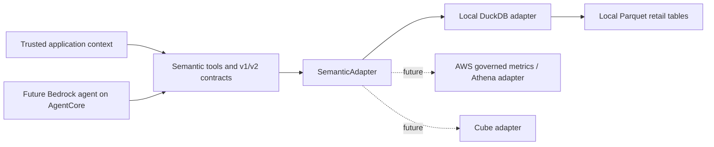

# Architecture

## Boundaries

The agent consumes backend-independent semantic contracts. AWS-specific and Cube-specific logic belongs in adapters. `contracts.py`, `contracts_v2.py`, and `adapter.py` must not import provider clients, DuckDB types, or SQL. Milestones 1–2 implement the local execution path; there is no agent loop or deployed service yet.

The four semantic tools are `discover_metrics`, `describe_metric`, `query_metric`, and `discover_dimensions`. Metric definitions own calculations, allowed dimensions, relationships, filters, units, and time semantics. The catalog is the source of governed configuration; an adapter translates the supported calculation into backend execution rather than accepting a user expression.

`catalog.MetricSpecification` is internal governed configuration. V1/v2 public metric definitions are explicit business projections. Description and dimension-discovery responses include logical names, business rules, units, order-item/order grains, and order-date semantics; v2 also describes precision, nullability, and original-period adjustments. Execution expressions, source mappings, and tenant-scoped join keys remain internal. Public JSON schemas omit those details too. Adapters translate the catalog's closed calculation identifiers into SQL; model-supplied expressions are never evaluated.

## Contracts and authorization

V1 models and net revenue wire schemas remain unchanged, with v1 discovery advertising only net revenue. V2 models add all five metrics, currency/count/ratio units, order grains, nullable ratio results, and explicit null currency for nonmonetary results. Separate typed requests select the version for each of the four operations; every response and nested object uses the matching version. New metrics through v1 fail clearly. Incompatible published changes require a new version.

Unknown fields and unsupported versions are rejected. Dates are date objects or ISO `YYYY-MM-DD` strings, never timestamps. A date range is `[start, end)` with `start < end`. Currency/ratio values serialize as decimal strings; counts as JSON integers. V2 forbids binary floats and validates unit/currency/value precision consistency.

`AuthorizationContext` is passed separately by trusted application code and contains a principal, tenant, and explicit allowed regions. The context is never part of model-visible request schemas. Empty region scope denies all access. All four adapter methods check the context; query execution and dimension discovery also apply tenant and region restrictions. Requests cannot override these restrictions. The local CLI constructs its context as application configuration, not as command-line identity options.

This enforces a local trust boundary. Production must authenticate the application principal and derive tenant and region scope from verified claims or a policy service before constructing this context. A Pydantic object alone does not authenticate a user.

## Local storage and execution

Six required Parquet files contain customers, products, orders, order items, payments, and refunds. A seventh, optional `returns.parquet` stores physical item-return events with tenant-scoped event keys, quantities, event/received dates, and explicit received/pending/rejected statuses. It is required by return-rate execution, even for empty query ranges; absence raises a missing-source error, while an empty typed source is valid. Legacy six-table snapshots retain net revenue and support the other metrics except return rate.

Monetary values are signed 64-bit integer cents at rest. Synthetic returns use a separate seed stream after original records are complete; frozen logical fingerprints protect the original six tables for two seeds. Order region and channel are historical attributes stored on the order, so customer changes cannot restate dimensions.

The adapter loads a snapshot into its own in-memory DuckDB connection. Exact repeated records collapse by tenant-scoped business key; contradictory records sharing a key fail. Approved refunds aggregate per item before item joins. Received physical returns first become distinct returned-order flags. Eligible items then aggregate into one row per order, followed by the requested output groups. Payments never join these aggregations, and an order without items is excluded. The existing net revenue formula and eligibility are unchanged.

Ratios divide the final grouped integer numerators and denominators, never subgroup averages. Integer quotient/remainder arithmetic implements final ROUND_HALF_UP without intermediate rounding or dependence on the caller's Decimal precision. Average order value has two places and return rate six; zero denominators yield null. Return-rate flags cannot count an order more than once. Request/auth values use bound parameters; SQL identifiers come from the governed catalog.

Local snapshot ingestion assumes application-controlled Parquet. This milestone does not implement arbitrary uploads, schema migrations, streaming updates, warehouse governance, or a policy service. Reopen the adapter to observe changed files. Use its context manager to close the connection.

Ingestion requires exact storage types, nonnull required fields, nonnegative source amounts, positive item quantities, discounts no greater than line gross, and tenant-scoped relationships. Approved refunds require an approval date; received returns require a received date. Return quantities must be positive and no greater than purchased item quantity. Optional sources are validated when present. These checks reject malformed snapshots rather than silently discarding records. Over-refunds can produce negative net revenue/AOV. There is no full financial or cumulative physical-return ledger reconciliation.

## Verification automation

Push/PR CI uses read-only repository permissions, Python 3.12, immutable action SHAs, pinned Poetry 2.3.1 in a separate environment, and locked project installation. It checks the lockfile, tests, Ruff lint/format, and mypy. CI has no AWS credentials. Local work continues in the existing `enterprise-analytics` Conda environment; CI creates an isolated project environment instead. Hosted workflow execution requires a user-initiated push and is not part of local verification.

## Future integrations

Milestone 3 is the AWS data layer and Athena adapter with parity tests. Milestone 4 adds Bedrock and AgentCore. Cube is a later separate adapter. Before any external integration, validate SDK usage against current official documentation and record it. Provider-specific identity propagation, query lifecycle, credentials, and errors remain in adapters or trusted hosting code. Do not make AWS calls during milestone 2.

For local implementation, official references checked on 2026-11-05 include [DuckDB's Python API](https://duckdb.org/docs/stable/clients/python/overview), [Pydantic configuration](https://docs.pydantic.dev/latest/api/config/), and [Poetry project configuration](https://python-poetry.org/docs/pyproject/).

CI references checked on 2026-11-05: [checkout v7.0.1](https://github.com/actions/checkout/releases/tag/v7.0.1), [setup-python v7.1.0](https://github.com/actions/setup-python/releases/tag/v7.1.0), [Poetry installation/CI guidance](https://python-poetry.org/docs/#ci-recommendations), and [Poetry CLI](https://python-poetry.org/docs/cli/). Action release refs were resolved to full commit SHAs in the official repositories. Local `poetry sync --help` confirmed the pinned Poetry version supports the workflow flags.
