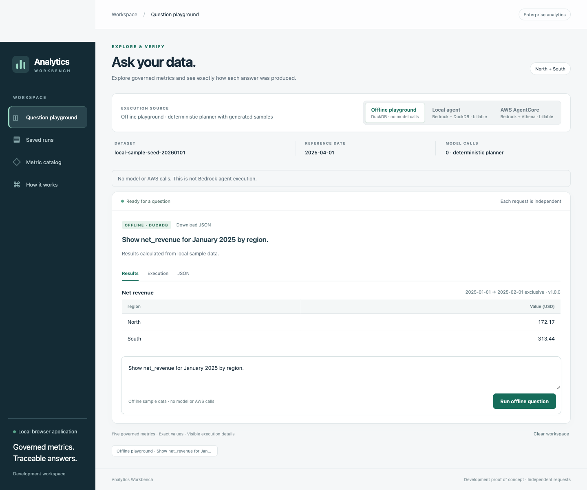
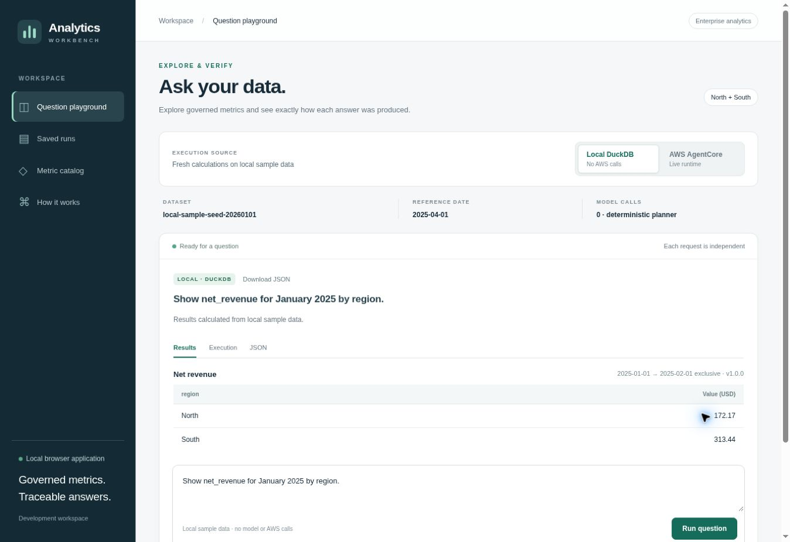

# Analytics Workbench

The Workbench provides three explicit execution modes and offline saved-report viewing
for the separately requested UI scope after milestones 1–5. The default **Offline
playground** creates no AWS session. **Local agent** uses the existing
`BedrockAnalyticsAgent` with DuckDB and makes billable Bedrock calls. **AWS AgentCore**
uses that agent with Athena after the matching reviewed release is deployed and verified.
The catalog, v2 contracts, question guard and semantic tools remain shared.



## Current workbench: four accepted streaming models

Open **http://127.0.0.1:8501/?mode=live**. The current server exposes **Amazon Nova
Lite, DeepSeek V3.2, Qwen3 235B and Mistral Large 3** in both **Local agent** and
**AWS AgentCore** modes. Select a model, enter a question and submit it. The input
clears immediately, and real provider words stream into a readable answer while
exact semantic values remain available in the result details/download.

The approved execution reached **partial model acceptance**: the 15 AWS cases
produced **9 passes and 6 failures**, with both required cases passing for each of
the four enabled models. Four actual Local browser questions and one AWS Nova
browser question then passed Q18's complete request/value, streaming and composer
checks. Anthropic Sonnet/Opus and OpenAI Astra/Sol remain quarantined after Bedrock
account-availability 403 responses; Gemma reached its iteration limit, and Llama's
all-five case failed after invalid tool arguments/token limits. No failed model
is silently retried or replaced.

The separate campaign **`bedrock-stream-workbench-v1-01`** is **20/40 used**, with
**18 ordinary questions remaining**, protected cleanup **1** and unavailable reserve
**1**. Expiry is **November 15, 5:59 p.m. CST** (`2026-11-15T23:59Z`). Read the
persistent counter after later questions; do not spend a protected slot or reset
any campaign. The old Nova ledger stays separate at **3/20**.

Fresh read-only proof at **2026-11-13T15:59:41Z** verified all ten candidate bindings
on Runtime/DEFAULT **READY v4**, stable stacks, exact templates/configuration/code,
both policies, seven-day retention and canonical publication. The frozen candidate
is **f2755c33…**, S3 VersionId **xnQiGsnGRkgFV3ktJ2DfhUbOClx9gVEn**. Legacy v15,
M3 infrastructure and canonical inputs remain unchanged. See the
[executed proposal and exact restart command](ui-model-workbench-deployment-proposal.md).
The workbench's source, review and release pins must still match on restart;
the historical Nova-only commands below are not the current launcher.

## Merged application and historical interactive sessions

The Workbench merged through [PR #8](https://github.com/sureshkm-ai/enterprise-analytics-agent/pull/8)
at `e222875` on November 11, 2026. Full validation merged through
[PR #9](https://github.com/sureshkm-ai/enterprise-analytics-agent/pull/9) at `1dfd788`;
[main CI](https://github.com/sureshkm-ai/enterprise-analytics-agent/actions/runs/43100659276)
passed for that merge. The implementation and completed live acceptance are preserved.

[Interactive session 02](ui-interactive-session-02.md) was approved at `319a872`.
At its original activation, both **Local agent** and **AWS AgentCore** were enabled
at **http://127.0.0.1:8501**. Later source changes invalidate that shared launcher's
local/remote source-equality check; do not use the historical command below as the
current live launch. The [AWS-only accepted Nova binding](ui-accepted-nova-live.md)
was explicitly approved by the user at `1d7e8f6`, binding review `e6fdf135…`.
It was activated at **http://127.0.0.1:8501/?mode=live** before the current workbench.
Fresh read-only proof at
**2026-11-13T00:13:44Z** verified the exact retail-v1 Runtime/DEFAULT **READY v15**;
the actual browser check selected Nova and verified **Ask AWS** without submitting
a question. The existing counter stayed **2/20 used, 17 regular questions remaining**.
At that historical activation, Local Bedrock and other models stayed disabled.
That JSON release showed progress followed by validated final output, rather than
provider-word streaming. It has been replaced locally by the workbench above;
its Runtime and separate ledger remain preserved. The required
original Q18 verification passed its full request/result gate:
**110.25 USD [2025-03-31,2025-04-01)**. Fresh proof at **21:52:13Z** on November 11,
2026 verified the matching source/artifact/configuration/canonical data and
Runtime/DEFAULT **READY v15**, stack UPDATE_COMPLETE. No deployment, IAM change,
upload or rebuild was needed.

At activation, usage was **1 verification, 1 Runtime invocation, 0 ordinary questions
and 0 direct local Converse calls**, leaving **18 regular questions total across both
modes** through **November 13, 5:59 p.m. CST** (`2026-11-13T23:59Z`). The protected
original-rollback slot is unavailable and cannot fund a question or retry. Browser
mode checks submitted no ordinary question. Historical ledgers/reviews remain intact. The UI's durable counter is authoritative as the user submits questions.

A later local ledger inspection for the current UI update found **2/20 used**:
the Q18 verification and one completed user question, leaving **17 regular questions**.
This is a local counter observation, not another invocation or fresh AWS readiness
assertion. The activation's 18-question record remains unchanged historical evidence;
read the persistent counter for subsequent usage.

The following is the **historical shared launcher**, preserved for the activation
record. Use the [current workbench launch](ui-model-workbench-deployment-proposal.md)
for this changed checkout; the plain UI command starts offline mode only.

```sh
conda activate enterprise-analytics
poetry run python -m enterprise_analytics_agent.ui \
  --allow-live \
  --shared-review evaluations/ui-shared/interactive-02.proposed.json \
  --release-record artifacts/ui-shared/interactive-02-preparation/release-record.json \
  --canonical-dir artifacts/milestone-5/canonical/retail-v1 \
  --report artifacts/ui-shared/replay-aws-agentcore.json \
  --port 8501
```

Neither launcher resets the allowance or repeats Q18. The existing counter and fresh
per-question release checks remain enforced. Offline playground and Saved runs remain
AWS-free; current status must not claim readiness when the selected backend is absent
or source verification fails.

## Submit, follow progress and choose a model

Clicking the run button captures the question and **clears the text box immediately**.
The submitted question stays with its answer in the results area. A failed request
does not refill the composer or submit it again; enter a new question only after
inspecting the displayed error and, for billable work, its retained counter evidence.

The browser reads a live newline-delimited JSON response from `/api/ask/stream`.
The current workbench first shows honest execution progress, then streams actual
provider characters matching the readable answer rendered from validated results.
The final word is withheld until terminal events and usage are checked. Exact
metric tables and diagnostics accompany the completed answer. Heartbeats are
progress rather than model tokens. The historical Nova v15 JSON handler remains
unchanged and did not provide provider-word streaming.
Closing the browser does not retry a billable request or release its execution
lock while backend accounting continues.

The **Model** selector lists server-configured models available for the selected
agent mode. The current accepted choices are **Amazon Nova Lite**, **DeepSeek V3.2**,
**Qwen3 235B** and **Mistral Large 3**. Six quarantined choices remain disabled;
their catalog entries do not establish access or authorize a retry.
The offline playground has no Bedrock model to select.

The browser sends an opaque `model_key` for UI routing. Python resolves it against
the configured bindings and removes it before the backend receives the request;
the AgentCore payload remains question-only. Unknown choices or choices unavailable
for the selected mode fail before dispatch; returned model diagnostics must match
the selected binding. Neither a label nor a browser-supplied model ID can override the
server's model configuration, authorization, release checks or question allowance.

AgentCore invocation selects a runtime and endpoint qualifier; model choice belongs
to the hosted application, rather than an invocation-level model parameter. Its
HTTP contract supports JSON or SSE when the application implements the appropriate
response. [InvokeAgentRuntime](https://docs.aws.amazon.com/bedrock-agentcore/latest/APIReference/API_InvokeAgentRuntime.html),
[HTTP protocol contract](https://docs.aws.amazon.com/bedrock-agentcore/latest/devguide/runtime-http-protocol-contract.html).
The new release implements upstream word streaming; enabling it still requires
its separately reviewed runtime, applicable `bedrock:InvokeModelWithResponseStream`
access and model-specific transport/acceptance checks.
[ConverseStream](https://docs.aws.amazon.com/bedrock/latest/APIReference/API_runtime_ConverseStream.html),
[client-side tool use](https://docs.aws.amazon.com/bedrock/latest/userguide/tool-use-client-side.html).
The initial streaming Nova create stopped at verification, with no billable calls.
Its historical failures, completed deployment and failed live acceptance are recorded below.

## Historical Bedrock-only preparation and failed rollouts

The [new deployment/evaluation plan](bedrock-multimodel-streaming-plan.md) covers
ten isolated model runtimes, including a streaming Nova baseline. The catalog
offers Anthropic Claude, OpenAI GPT through Bedrock, Google **Gemma through Bedrock
Mantle**, Meta Llama, DeepSeek, Qwen and Mistral. Google Gemini and direct provider
APIs are outside this scope. The optional GPT-OSS catalog entry is not one of the
ten reviewed deployments. Execution was approved on November 11, 2026; the
[administrator guide](bedrock-streaming-administrator-steps.md) records the verified
directory grant/model agreements and later query-role trust handoff. Only the new
Nova stack reached CREATE_COMPLETE/READY v1. The user approved the
[recovery](bedrock-streaming-recovery-plan.md) at **7dad05a**, covering the policy
representation correction and scoped workload logging grant. Fresh preflight
passed, the reviewed unused Nova stack was deleted, and all ten corrected stacks
verified **CREATE_COMPLETE / Runtime and DEFAULT READY v1**, exact proofs and
seven-day retention. Administrator-applied trust readback and release binding
passed. Nova Q18 passed with provider streaming; the all-five question had the
correct complete plan/results but failed `token_limit` before presentation.
Acceptance stopped with no other model invoked or accepted UI binding. Protected
legacy **v15** cleanup smoke passed. Campaign **3/40** is closed (two ordinary,
one cleanup), with reserve untouched; all new choices stay disabled. The source,
frozen ZIP/version and existing permissions remain preserved. The
[completion replacement](bedrock-streaming-completion-plan.md) was explicitly
approved at **f591498**. One upload returned actual VersionId
**PQbNv3gkC1HwVYNNiAe95r1XuQDkfKvb**; all ten existing stacks and Runtime/DEFAULT
passed exact **UPDATE_COMPLETE / READY v2** proofs. Nova Q18 (**110.25 USD**) and
all-five regional acceptance passed with exact independent results and provider
streaming. Sonnet Q18 then failed the first Converse call with
**AccessDeniedException / model_error**, without semantic queries. Ordinary
dispatch stopped after three attempts, no other model was invoked and no accepted
UI binding exists. Mandatory original restoration passed: all ten original
streaming code/configuration bindings verified **UPDATE_COMPLETE / Runtime and
DEFAULT READY v3**. The protected legacy-v15 Q18 smoke passed **110.25 USD** at
approximately **22:29:52Z**. All new choices stay disabled. Use the offline playground/saved reports until a matching release passes
all acceptance gates; do not bypass review/source checks or replay this operation.

The implementation commit **f591498** is pushed; [push CI 43316129337](https://github.com/sureshkm-ai/enterprise-analytics-agent/actions/runs/43316129337) and [PR CI 43316722939](https://github.com/sureshkm-ai/enterprise-analytics-agent/actions/runs/43316722939) passed for that commit. Those checks do not cover later outcome documentation.

Local Bedrock and AWS modes share `BedrockAnalyticsAgent` semantic contracts and
tools, preserving base-agent defaults. Streaming-only trusted completion resolves
missing exact queries at capacity boundaries. At most five planning calls precede
one tool-free presentation call,
within six model calls and 12,000 tokens total. At a planning-capacity boundary, only missing queries from the exact resolved
question may execute through the governed adapter; all requested successful
results must exist before an answer. Invalid/error plans remain failures, and
there is no sixth planning call. Native models use Converse then
ConverseStream; Gemma uses signed AWS Mantle chat with sequential tools.

Only actual provider text matching the validated canonical answer's exact prefix
is published at complete word boundaries. Amounts/dates cannot be replaced by
model calculations; unfinished words and the last word wait for validation.
Private reasoning is not displayed. A malformed, changed or interrupted provider
stream is labeled, with the validated answer retained when available. It triggers
no retry, replacement model or typing animation.

The completion review, uploaded version, assemblies, SDK receipts and campaign are
separate. The parent remains closed **3/40**. The approved child has **37** total
slots: 20 acceptance, 15 user questions, one protected cleanup and one unavailable
reserve; expiry remains `2026-11-15T23:59Z`. The child is closed/blocked **4/37**
(ordinary 3 + cleanup 1), aggregate **7/40**, with no incomplete attempt. The
numeric remaining ordinary quota is unusable. New UI choices stay disabled.
The supplied Sonnet policy matches; administrator simulation allows both Bedrock
actions on all four concrete resources with no missing context, and the user
reports no permissions boundary. Read-only verification identifies this as the
Organizations management account, whose roles are not restricted by SCPs. No
missing permission or source-routing defect is established. Next diagnose the
original full service error from retained evidence/support material; its message,
request ID, session, resource and conditions remain unavailable. Do not repeat
these IAM requests. No retry, new campaign, permission change or reserve use
follows from the remaining quota.

The legacy session 02 command is a historical Nova-only launch for its accepted
v15 source/release. Current local source differs from that frozen closure; do not
bypass its source check to enable billable modes. Its last observed counter remains
**2/20 used, 17 regular remaining**, subject to later usage and expiry; this
completion campaign spent none of those slots. Historical shared-UI live results
do not cover this streaming release. Exact f591498 CI and the two passed Nova
streaming gates are recorded above. Offline playground and Saved runs remain
available with the ordinary no-argument launch.

## Approved live acceptance completed

On November 11, 2026, Q18 and **18/18 paired UI outcomes** passed against independent
goldens. Final proof verified candidate/retail Runtime/DEFAULT **READY v13**, stack
UPDATE_COMPLETE. Usage **19/20**: all 18 regular slots plus protected verification;
rollback unused. The candidate remains deployed; historical M4/M5 original-v12
restoration evidence is unchanged. See [the acceptance record](ui-shared-code-live.md).

A later separately approved full-test campaign restored and finally verified the
same candidate/retail artifact/configuration on **READY v15** at 19:59:56Z on
November 11, 2026. All 85 live tests passed; see [the evidence](../evaluations/full-live/acceptance-2026-11-11.json).
This did not refresh the completed UI allowance or its historical v13 release record.
The completed historical review remains offline/replay-only. The separately approved
session 02 above has passed its own Q18 gate; its current persistent counter determines
the remaining user-owned questions.

All regular slots in the historical session are spent, so its completed review cannot
restart billable mode. Only session 02's separate allowance funds the newly enabled
modes. Inspect the actual nine historical AWS responses without another call:

```sh
conda activate enterprise-analytics
poetry run python -m enterprise_analytics_agent.ui   --report artifacts/ui-shared/replay-aws-agentcore.json --port 8501
```

Choose **Saved runs**. This export is an explicitly labeled replay derived from the
paired report. Use `replay-local-agent.json` for the nine local responses. Reports
remain in the original checkout; omit `--report` in a fresh clone.

## Start the offline playground

From the repository root, use the existing environment:

```sh
conda activate enterprise-analytics
poetry run python -m enterprise_analytics_agent.ui
```

Open **http://127.0.0.1:8501**. If occupied, add `--port 8502` and use the printed URL.
Stop with Ctrl+C. No frontend build, Node installation, extra dependency, credentials
or database setup is needed. Merely opening the application, switching modes, browsing
the catalog or viewing a saved report sends no model or Runtime request.

The playground creates temporary Parquet using the existing fixed-seed generator.
The existing question guard produces validated requests; DuckDB computes the values.
Its planner is deterministic, and its generated samples are not the canonical retail
publication. The trusted scope is `retail_demo`, North/South, with reference date
`2025-04-01`. Unsupported intent receives clarification. History buttons redisplay
answers without supplying conversation history to another question.

Try these in the offline playground:

| Question | What it exercises |
| --- | --- |
| Show net_revenue for January 2025 by region. | Exact currency and regional grouping |
| Show gross_sales and net_revenue for January 2025 by region. | Multiple metrics |
| Show order_count for January 2025 by region and channel. | Count grain and two dimensions |
| Show average_order_value for March 2025 by channel. | Aggregate ratio and rounding |
| Show return_rate for January 2025 by region. | Physical returns versus refunds |
| Show net_revenue for yesterday. | March 31, 2025, from the fixed reference date |
| List available metrics. | Governed discovery |
| Describe average_order_value. | Metric definition |
| List dimensions for net_revenue. | Scoped dimension discovery |

**Results / Execution / JSON** expose the validated response. Money remains exact
decimal strings; JavaScript does not calculate metric values. Rates are fractions,
null ratios remain distinct from zero, and absent diagnostics are labeled unreported.

## Understand the modes and current deployment

The current workbench uses the new frozen **f2755c33…** package and separate
approved review/releases, with four accepted models. Final read-only proof at
**15:59:41Z on November 13, 2026** verified all ten v4 bindings; readiness is
distinct from each model's acceptance. Every question rechecks its exact release
and canonical publication before reservation.

| Mode | Data and reference date | Execution and cost |
| --- | --- | --- |
| Offline playground | Temporary `local-sample-seed-20260101`; `2025-04-01` | Deterministic planner, real DuckDB, no AWS/model calls |
| Local agent | Verified canonical `retail-v1`, `retail_demo`, North/South; `2025-04-01` | Shared Bedrock agent with DuckDB; billable, at most six Converse attempts per question |
| AWS AgentCore, shared release | Same reviewed retail scope/model/limits as local agent | Shared Bedrock agent with Athena; one Runtime attempt per question, no invocation retries |
| Saved runs | Whatever the saved file records | Offline typed inspection, no new execution or acceptance |

The two agent modes are disabled by default. Local agent execution is **not offline
model execution**: its button and mode notice disclose Bedrock usage before submission.

Historical read-only checks on November 10, 2026, found original/parity
Runtime and DEFAULT **READY v12**, before the separately approved v13 deployment. Its original artifact differs from the local Q18
correction in `bedrock_agent.py` and `agent/questions.py`. It was not the proposed shared
retail release. At that historical checkpoint the frozen candidate matched all **25** audited shared source
files and could be reused without rebuilding or uploading a ZIP. Its dependency/build,
configuration, artifact and canonical-data evidence are recorded in
[the shared-code proposal](ui-shared-code-live.md). This source comparison alone does
not prove which code is active. The approved execution and final v13 proof above
establish the tested candidate behavior.

Read-only publication verification also checked all eight current object identities,
seven exclusive source prefixes and seven actual Glue schemas/locations. The retained
proof is `artifacts/ui-shared/preflight/20261110T212343Z/publication-proof.json`.
Every candidate deployment preflight and new shared question repeats these bounded
checks; drift blocks execution before reserving a question.

The shared deployment and live comparison **passed within the separately approved
scope**. Direct developer Bedrock access and the runtime candidate-key read grant
are covered by the supplied administrator-console policy contents recorded in
[the policy review](ui-shared-code-live.md#administrator-console-policy-review--november-11-2026).
Current attachment/effective access are not independently verified; denied IAM
inspection is not proof of missing access. No additional grant is proposed.
The accepted execution exercised direct Bedrock and candidate Runtime access;
policy attachment enumeration remains unverified. No upload/IAM change occurred;
historical ledgers remain unchanged.

## Inspect saved acceptance without new calls

Choose **Saved runs → Choose JSON file** and select a retained `report.json` or a
downloaded AgentResponse JSON. Files go only to the loopback application, are validated,
and are not persisted by the upload route. Refreshing clears uploaded report state.
This viewer preserves recorded verdicts; it does not rejudge acceptance or infer
success from a filename. The upload limit is 16 MiB / 200 cases.

For the retained M5 report in the original checkout:

```sh
poetry run python -m enterprise_analytics_agent.ui \
  --report artifacts/milestone-5/q18-recovery-v1/operations/20261110T173634Z/live/suite/report.json
```

Ignored reports and frozen artifacts are unavailable in a fresh clone. Do not fabricate
or regenerate historical evidence to fill the view.

## Shared-release operator workflow — completed execution record

The concrete proposed resources, permission prerequisites, nine paired questions,
expiry, cost limits and rollback gates are in
[shared code and live testing](ui-shared-code-live.md). Its proposed review is
`evaluations/ui-shared/review.proposed.json`: **20 total question attempts**, comprising
**18 regular attempts + one protected Q18 verification + one protected original rollback
smoke**, expiring **2026-11-11T23:59:00Z**. Both agent modes share that allowance.
The historical M4/M5/repair/continuation/recovery counters cannot fund these calls.
The approved execution consumed 19 attempts and all regular slots. The remaining
protected smoke cannot fund ordinary questions; do not reuse or reset this review.

`infrastructure.agentcore.ui_workflow` prepares/reviews existing assemblies and manages
bounded deployment reconciliation. It never invokes a model. Offline preparation
already created `artifacts/ui-shared/deployment/{candidate,rollback}` and its hashed
`assembly-review.json`; preserve that directory. For a separate offline reproduction,
choose an unused output directory:

```sh
poetry run python -m infrastructure.agentcore.ui_workflow prepare \
  --review evaluations/ui-shared/review.proposed.json \
  --output artifacts/ui-shared/deployment-recheck
```

The read-only preflight uses only `analytics-dev`, account `453711491609`, region
`us-west-2`, and writes new evidence without changing AWS resources:

```sh
poetry run python -m infrastructure.agentcore.ui_workflow preflight \
  --review evaluations/ui-shared/review.proposed.json --kind original \
  --output artifacts/ui-shared/preflight/fresh-original.json
```

**The following commands document the completed approved execution. Do not repeat
them or use the completed review for another demonstration.** Output
paths are write-once and must be unused. Do not change campaign IDs or delete evidence
to bypass an existing reservation, failed run or unresolved process journal.

```sh
poetry run python -m infrastructure.agentcore.ui_workflow deploy \
  --review evaluations/ui-shared/review.proposed.json \
  --prepared-dir artifacts/ui-shared/deployment \
  --output artifacts/ui-shared/operations/approved-deploy \
  --execute-approved

poetry run python -m enterprise_analytics_agent.adapters.ui_shared \
  --purpose verification --invoke-live \
  --review evaluations/ui-shared/review.proposed.json \
  --release-record artifacts/ui-shared/operations/approved-deploy/release-record.json \
  --output artifacts/ui-shared/verification.json
```

Deployment binds the actual resulting version rather than assuming v13. It reconciles
CloudFormation template/parameters and full Runtime/DEFAULT artifact, configuration,
policies and readiness; READY alone is insufficient. Success leaves the shared candidate
deployed. The protected verifier fixes its own question to **“Show net_revenue for
yesterday.”** and requires the complete independent Q18 request/result: **110.25 USD**
for **[2025-03-31, 2025-04-01)**. Normal shared questions remain disabled until it passes.

During acceptance, both shared agent modes were launched with this command; it now
correctly refuses the completed regular allowance:

```sh
poetry run python -m enterprise_analytics_agent.ui \
  --allow-live \
  --shared-review evaluations/ui-shared/review.proposed.json \
  --release-record artifacts/ui-shared/operations/approved-deploy/release-record.json \
  --canonical-dir artifacts/milestone-5/canonical/retail-v1
```

There is no automatic question on startup or mode selection. Browser payloads contain
only question, routing mode and deduplication ID. They cannot set profile, model,
authorization, SQL, history, reference date, runtime configuration or protected purpose.
AgentCore receives the existing question-only `AgentRequest`. Local authorization is
server-created; deployed authorization comes from trusted Runtime configuration.

Each new question verifies source/data/release, then durably reserves before dispatch.
The separate SDK journal counts local Converse attempts and Runtime invocations.
Failures and unknown outcomes stay spent and stop regular execution; no automatic
SDK invocation retry or reservation refund occurs. Successful duplicate IDs replay
saved results. **Clear workspace** affects only the browser display.

Evidence is under `artifacts/ui-shared/<campaign_id>/`: `question-attempts.jsonl`, exclusive
`reservations/`, `sdk-attempts.jsonl` and SDK receipts, `operator-reads.jsonl`, per-request
preflight JSON and protected verification output. Preserve the review hash binding,
all evidence and the existing operator/deployment guards across restarts.

## Historical shared-release failure, expiry and original rollback

The procedure below belongs to the completed original shared release. The current
workbench uses its own [approved failure/restoration procedure](ui-model-workbench-deployment-proposal.md);
an isolated completed model failure quarantines that model, while incomplete
accounting or an unresolved deployment blocks the full session. Do not run the
historical rollback commands against the new scope.

A failed candidate deployment triggers the operator's mandatory original restoration
when process guards allow. A failed Q18 or paired-comparison gate requires explicit
original restoration and the protected smoke under the approved procedure:

```sh
poetry run python -m infrastructure.agentcore.ui_workflow restore \
  --review evaluations/ui-shared/review.proposed.json \
  --prepared-dir artifacts/ui-shared/deployment \
  --output artifacts/ui-shared/operations/approved-rollback \
  --execute-approved

poetry run python -m enterprise_analytics_agent.adapters.ui_shared \
  --purpose rollback_smoke --invoke-live \
  --review evaluations/ui-shared/review.proposed.json \
  --release-record artifacts/ui-shared/operations/approved-rollback/rollback-record.json \
  --output artifacts/ui-shared/rollback-smoke.json
```

The smoke checks original parity North **28.50 USD** / South **13.00 USD**. Restoration
binds its actual resulting version, preserves the frozen original artifact/version and
disables shared UI execution. It does not claim that the original matches local Q18 code.
Inspect retained controller/process diagnostics before restoring after interruption;
never overlap deployments or bypass an unresolved journal. Retain primary and rollback
failures separately. Expiry blocks new billable calls, including a smoke; nonbillable
original cleanup remains available. If a required smoke cannot run within approval,
record that gap and obtain a new decision rather than resetting the allowance.

## Legacy original-v12 UI path

The initial UI implementation used the existing original/parity v12 deployment. This
remains a separate **legacy** option; it does not establish shared-code equivalence.
Its `local-ui-live-v1` review requires the exact original v12 checkpoint and a separately
approved cap/expiry under an unused `ui-demo-...` campaign. The old launch form is:

```sh
poetry run python -m enterprise_analytics_agent.ui \
  --allow-live --live-review artifacts/ui-demo/review.json
```

Do not combine `--live-review` with shared-release arguments. The v12-only gate must
fail after any version-changing deployment, even when the original artifact is restored.
Its historical evidence stays under `artifacts/ui-demo/<campaign_id>/`, separate from
shared and milestone campaigns. This command and an old allowance are not permission
for the new release proposal.

Historical screenshot from the initial deterministic/legacy UI implementation:



## Code map and verification

| Read in order | Responsibility |
| --- | --- |
| `ui/assets/index.html`, `style.css`, `app.js` | Three-mode presentation, exact tables, safe text rendering |
| `ui/server.py`, `ui/models.py`, `ui/__main__.py` | Loopback HTTP, strict payloads, explicit startup gates |
| `ui/local.py`, `agent/questions.py` | AWS-free playground and shared question scope |
| `adapters/ui_local_agent.py`, `adapters/bedrock_agent.py` | Injected local runner and existing shared agent |
| `contracts_v2.py`, `catalog.py`, `agent/tools.py` | Semantic contracts, definitions and tool dispatch |
| `adapters/duckdb.py`, `adapters/athena.py` | Backend calculations and trusted restrictions |
| `ui/shared.py`, `adapters/ui_shared.py`, `adapters/ui_release.py` | Shared budget, SDK attempts, release/data proof and protected gates |
| `ui/live.py`, `adapters/ui_live.py` | Historical original-v12 review/ledger path |
| `hosting/application.py` | Existing workload-credential runtime using the shared agent |
| `adapters/bedrock_model_catalog.py`, `streaming_agent.py`, `bedrock_word_stream.py`, `bedrock_mantle.py` | New catalog, bounded shared semantic loop wrapper and canonical provider-word transports |
| `ui/model_streams.py`, `adapters/model_stream_ui.py`, `model_stream_cli.py` | Separate proposed review/ledger, release proof, authored acceptance and protected cleanup |
| `hosting/streaming_server.py`, `infrastructure/cdk/streaming_app.py` | SSE hosting and isolated stacks; completion updated ten targets to v2; Nova gates passed, Sonnet denied; original code/config restored on v3 and legacy-v15 smoke passed; child closed 4/37, new choices disabled |
| `infrastructure/agentcore/ui_workflow.py`, `source_audit.py` | Offline assembly/source review and guarded release operator |

Package paths are relative to `src/enterprise_analytics_agent/`, except infrastructure.
See [architecture](architecture.md), [metric definitions](metric-definitions.md) and
[progress](progress.md) for decisions and actual verification results. UI tests cover
HTTP isolation, independent DuckDB expectations, injected shared-agent behavior, source
and release drift, actual publication bindings, durable quotas/SDK receipts, failure
recovery, protected full-Q18 judging, and offline complete CLI flows.

The server binds only `127.0.0.1`, checks Host/Origin and a per-process POST token,
serves an asset allowlist and applies a restrictive content policy. There are no external
fonts, scripts or trackers. It is a single-user development application. The standard
library [HTTP server](https://docs.python.org/3.12/library/http.server.html) is used only
for this local scope; AWS dispatch uses the existing
[AgentCore invocation API](https://docs.aws.amazon.com/boto3/latest/reference/services/bedrock-agentcore/client/invoke_agent_runtime.html).
